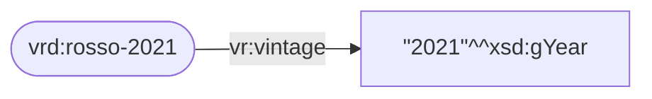

# The RDFSharp manual

This folder is the source of https://mdesalvo.github.io/RDFSharp/, built by GitHub Pages with Jekyll from the `main` branch. It is not part of the NuGet package.

## Preview it locally

```shell
cd docs
docker run --rm -p 4000:4000 -v "$PWD":/srv/jekyll jekyll/jekyll:pages jekyll serve --host 0.0.0.0 --baseurl /RDFSharp --force_polling
```

Then open http://localhost:4000/RDFSharp/. The `jekyll/jekyll:pages` image carries the same Jekyll, kramdown and Rouge that GitHub Pages uses.

## How it is organized

| Path | Holds |
|---|---|
| `_data/nav.yml` | the index: groups, pages and their order. The order is the reading order, which the pager at the foot of every page follows |
| `_layouts/default.html` | the only layout: top bar, index, page header, pager, footer |
| `_includes/` | the logo and the hand-drawn graph of the home page |
| `assets/css/site.css`, `assets/js/site.js` | the whole look and behaviour, no framework |
| `assets/data/` | the Vallerosa files every example works on |
| `index.md`, `getting-started.md`, `vallerosa.md`, `architecture.md`, `going-further.md` | the pages outside the three layers |
| `model/`, `store/`, `query/` | one Markdown file per page of each layer |

A new page needs a file and a line in `nav.yml`. Its front matter:

```yaml
---
title: Property paths                       # as in nav.yml
permalink: /query/property-paths/           # as in nav.yml
tagline: Walking chains of links in one step   # one line, shown in italics under the title
lede: Find every wine of Tuscany, whatever the depth of the area it comes from.   # one or two sentences
---
```

The eyebrow above the title ("Query · 4 of 16") is computed from `nav.yml`.

## The running example

Every example works on the Vallerosa case, described in `vallerosa.md` and in the three files of `assets/data/`. That page is the reference: use its IRIs, its prefixes (`vr:` for the vocabulary, `vrd:` for the data), its wines and its numbers. Do not invent new wines, producers or prices; when a chapter needs something new (a dish, a sommelier, a bad import), give it a `vrd:` IRI and keep it inside that chapter.

The vocabulary stays at RDF Schema level on purpose. Nothing in this manual uses OWL constructs beyond `owl:sameAs`: ontologies belong to the OWLSharp manual.

## Building blocks

**The story.** Each chapter opens with one or two sentences on what happens at Vallerosa, in a story block:

```markdown
> The cooperative has a new problem: two guides score the same wine differently.
{: .story}
```

**Pairs.** When an example has a standard form (Turtle, SPARQL, SHACL in Turtle) and a C# form, put both in a pair. Readers switch between them with tabs; when the lines are short enough, they appear side by side. The reader's choice of language is remembered across pages.

````markdown
<div class="pair" markdown="1">

```sparql
SELECT ?wine WHERE { ?wine a vr:RedWine }
```

```csharp
RDFSelectQuery query = new RDFSelectQuery() ...
```

</div>
````

Tab labels come from the fence language (`turtle`, `sparql`, `csharp`, `xml`, `json`, `shell`). For anything else, or to rename them, add `data-labels="N-Triples,C#"` to the div.

**Results.** What a query returns or what a serializer writes goes in a result block right after the code that produced it. It must be copied from a real run, never written by hand:

```markdown
<div class="result" markdown="1">

| ?WINE | ?LABEL |
|---|---|
| `https://vallerosa.example/id/rosso-2021` | `Vallerosa Red@EN` |

</div>
```

Add `data-label="catalog.ttl"` to name it after a file instead of "Result".

**Diagrams.** A fenced `mermaid` block becomes a diagram. Draw RDF in the manual's notation: resources are stadiums with the class `res`, literals are boxes with the class `lit`, blank nodes are stadiums with the class `blank`, predicates are labelled arrows. Write quotes inside labels as `#quot;`.

````markdown

````

A diagram earns its place when it shows a shape the text cannot: what a list or a reification turns into, how contexts split a store, where a federation sends a query. One per page at most, usually none.

**Notes.** A blockquote followed by `{: .tip}` or `{: .warn}` becomes a tip or a warning. Keep them rare.

## Writing rules

- English, second person, present tense. Plain words first, the term of art right after: "a literal, a plain value such as a year".
- Never a comma before "and", never a sentence that opens with "And" or "Or".
- C# follows the library: explicit types (`RDFGraph graph = new RDFGraph()`), fluent chains, one statement per idea. No `var`.
- Every example must compile and run against the current source of the library, not against older documentation. Every output shown must come from running it.

**Mermaid gotchas.** Never use `graph`, `end` or `subgraph` as a node id. Inside a label, write quotes as `#quot;` and the colon of an IRI scheme as `#58;` (`https#58;//...`): Mermaid otherwise takes an IRI for a Markdown link and refuses it.
