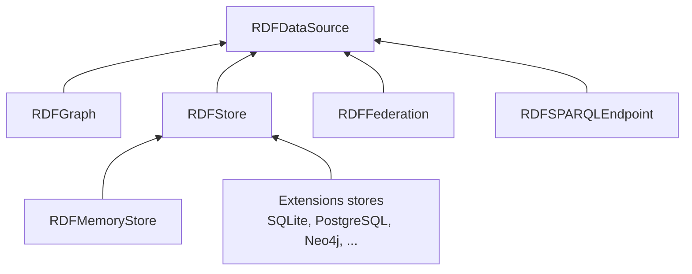

## Three layers

| Namespace | Holds |
|---|---|
| `RDFSharp.Model` | resources, literals, triples, graphs, namespaces, datatypes, RDF formats, SHACL |
| `RDFSharp.Store` | contexts, quadruples, stores and their formats N-Quads, TriX and TriG |
| `RDFSharp.Query` | the SPARQL 1.1 engine, codenamed **Mirella**: queries, updates, federations, endpoints, parser |

Each layer builds on the one before it.

## Data sources

A query runs on any `RDFDataSource`, with one method per kind: `ApplyToGraphAsync`, `ApplyToStoreAsync`, `ApplyToFederationAsync`, `ApplyToSPARQLEndpointAsync`.

| Kind | Holds |
|---|---|
| graph | triples, in memory |
| store | quadruples, in memory or on a database through [RDFSharp.Extensions](https://github.com/mdesalvo/RDFSharp.Extensions) |
| federation | other data sources, queried as one |
| SPARQL endpoint | a remote service, such as DBpedia |

A `SELECT` answers with a `DataTable`, an `ASK` with a boolean, a `CONSTRUCT` or a `DESCRIBE` with a graph.

## Conventions

| Convention | Means |
|---|---|
| **Fluent building** | methods that add something return their object, so calls chain |
| **Vocabularies** | the terms of RDF, RDFS, XSD, OWL, SHACL and other standards are constants of `RDFVocabulary`, such as `RDFVocabulary.RDF.TYPE` |
| **Registers** | `RDFNamespaceRegister` gives prefixes to the serializers, `RDFDatatypeRegister` knows the datatypes. Both are global |
| **Async** | operations have an `...Async` twin that returns a `Task`. The examples of this manual use it |
| **Exceptions** | one per layer: `RDFModelException`, `RDFStoreException`, `RDFQueryException` |
| **Targets** | `netstandard2.0` and `net8.0`. A few extras, such as `IAsyncDisposable`, need `net8.0` |
