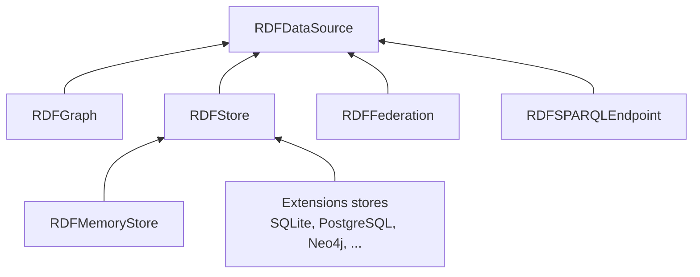
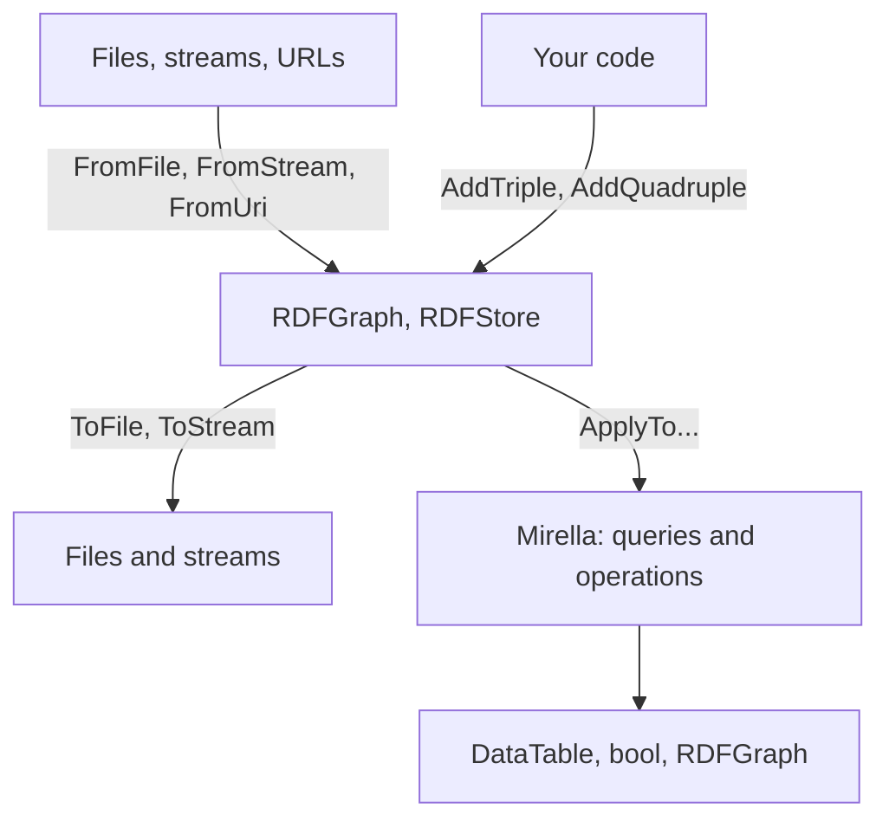

## Three layers, three namespaces

| Namespace | Layer | What you find there |
|---|---|---|
| `RDFSharp.Model` | Model | `RDFResource`, `RDFPlainLiteral`, `RDFTypedLiteral`, `RDFTriple`, `RDFGraph`; namespaces, datatypes and facets; containers and collections; the RDF formats N-Triples, Turtle, TriX and RDF/XML; SHACL shapes and validation |
| `RDFSharp.Store` | Store | `RDFContext`, `RDFQuadruple`, the abstract `RDFStore` and its in-memory implementation `RDFMemoryStore`; the formats N-Quads, TriX and TriG |
| `RDFSharp.Query` | Query | the SPARQL engine, codenamed **Mirella**: variables, patterns, filters, modifiers, property paths, aggregates, expressions; the four query forms; the SPARQL UPDATE operations; federations and SPARQL endpoints; a parser for SPARQL text |

Each layer builds on the one before it. A store is made of quadruples, which are triples with a context. A query runs over graphs and stores and answers with tables or new graphs.

## One idea: the data source

Everything a query can run on is an `RDFDataSource`. There are four kinds:



- a **graph** holds triples in memory
- a **store** holds quadruples, in memory with `RDFMemoryStore` or on a database through [RDFSharp.Extensions](https://github.com/mdesalvo/RDFSharp.Extensions)
- a **federation** groups other data sources and lets one query span all of them as if they were one
- a **SPARQL endpoint** is a remote service, such as DBpedia, that answers queries over HTTP

Every query has one method per kind: `ApplyToGraph`, `ApplyToStore`, `ApplyToFederation` and `ApplyToSPARQLEndpoint`. The query itself does not change. At Vallerosa a question about wine scores finds nothing on the catalog graph, which holds no scores. It answers on the store that adds the two guides or on a federation of the catalog and the guides.

## Where the data comes from and where it goes



Data enters a graph or a store from a file, a stream, a URL or your code; it leaves through files and streams. Queries answer according to their form: `SELECT` with a `DataTable`, `ASK` with a boolean, `CONSTRUCT` and `DESCRIBE` with a new graph.

## Conventions you will meet everywhere

**Fluent building.** Methods that add something return the object they were called on, so graphs, queries and shapes are built in one chained expression:

```csharp
RDFGraph graph = new RDFGraph()
    .AddTriple(firstTriple)
    .AddTriple(secondTriple);
```

**Built-in vocabularies.** The terms of RDF, RDFS, OWL, XSD, SHACL, FOAF, Dublin Core and many other standard vocabularies are ready as constants in `RDFVocabulary`, so you never type their IRIs by hand: `RDFVocabulary.RDF.TYPE`, `RDFVocabulary.RDFS.LABEL`, `RDFVocabulary.XSD.DECIMAL`.

**Two registers.** `RDFNamespaceRegister` knows the prefixes in use and lets the serializers write `vr:Wine` instead of the full IRI. `RDFDatatypeRegister` knows the datatypes, the standard ones and those you define. Both are shared by the whole application.

**Synchronous and asynchronous.** Every `ApplyTo...` method of queries and operations has an `...Async` twin returning a `Task`, so that the calling thread, for example the one of a user interface, does not wait for the answer.

**Three exceptions.** Each layer reports misuse with its own exception: `RDFModelException`, `RDFStoreException` and `RDFQueryException`. A triple whose predicate is a blank node, for example, is refused with an `RDFModelException` the moment you try to build it.

**Two targets.** The package targets `netstandard2.0` and `net8.0`. A few conveniences, such as `IAsyncDisposable` on graphs and stores, exist only on `net8.0` and later.
