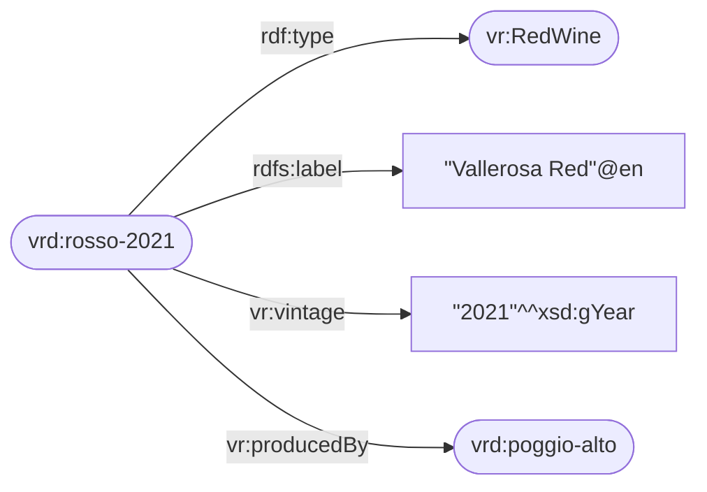

> The Vallerosa cooperative has decided to publish its catalog as linked data. Before anything else, someone has to write the first wine down.
{: .story}

## Install the package

RDFSharp is one NuGet package. It targets `netstandard2.0` and `net8.0`, so it runs on .NET Framework as well as on every modern .NET.

```shell
dotnet new console -n Vallerosa
cd Vallerosa
dotnet add package RDFSharp
```

The three layers live in three namespaces. Each chapter of this manual says which ones it needs; this page needs two.

```csharp
using RDFSharp.Model;   // resources, literals, triples, graphs, SHACL
using RDFSharp.Query;   // SPARQL queries and updates
```

## Write the first wine

A wine of the catalog is a **resource**: something with a name on the Web, an IRI. What we know about it is a set of **triples**, each one saying *subject, predicate, object*. The object can be another resource or a **literal**, a plain value such as a year or a name.

The Rosso di Vallerosa 2021 is a red wine, it has an English name, a vintage and a producer. Four triples:



Here they are in Turtle, the most readable of the RDF formats, next to the same triples built in C#.

<div class="pair" markdown="1">

```turtle
@prefix vr:   <https://vallerosa.example/vocab#> .
@prefix vrd:  <https://vallerosa.example/id/> .
@prefix rdfs: <http://www.w3.org/2000/01/rdf-schema#> .
@prefix xsd:  <http://www.w3.org/2001/XMLSchema#> .

vrd:rosso-2021 a vr:RedWine ;
    rdfs:label "Vallerosa Red"@en ;
    vr:vintage "2021"^^xsd:gYear ;
    vr:producedBy vrd:poggio-alto .
```

```csharp
RDFNamespace vr = new RDFNamespace("vr", "https://vallerosa.example/vocab#");
RDFNamespace vrd = new RDFNamespace("vrd", "https://vallerosa.example/id/");

RDFResource rosso = new RDFResource(vrd + "rosso-2021");
RDFResource poggioAlto = new RDFResource(vrd + "poggio-alto");

RDFGraph catalog = new RDFGraph()
    .SetContext(new Uri("https://vallerosa.example/catalog"))
    .AddTriple(new RDFTriple(rosso, RDFVocabulary.RDF.TYPE, new RDFResource(vr + "RedWine")))
    .AddTriple(new RDFTriple(rosso, RDFVocabulary.RDFS.LABEL, new RDFPlainLiteral("Vallerosa Red", "en")))
    .AddTriple(new RDFTriple(rosso, new RDFResource(vr + "vintage"),
        new RDFTypedLiteral("2021", RDFModelEnums.RDFDatatypes.XSD_GYEAR)))
    .AddTriple(new RDFTriple(rosso, new RDFResource(vr + "producedBy"), poggioAlto));
```

</div>

Two details of the C# side are worth a look:
- the vocabulary of RDF itself is ready in `RDFVocabulary`, so `rdf:type` is `RDFVocabulary.RDF.TYPE` and `rdfs:label` is `RDFVocabulary.RDFS.LABEL`
- `SetContext` gives the graph its own name: the cooperative's catalog lives at `https://vallerosa.example/catalog`

## Save it as Turtle

A graph writes itself to any of the standard formats. For the prefixes to appear in the file, register the two namespaces first: RDFSharp keeps a register of known prefixes and the serializers use it.

```csharp
RDFNamespaceRegister.AddNamespace(vr);
RDFNamespaceRegister.AddNamespace(vrd);

catalog.ToFile(RDFModelEnums.RDFFormats.Turtle, "catalog.ttl");
```

<div class="result" data-label="catalog.ttl" markdown="1">

```turtle
@prefix rdf: <http://www.w3.org/1999/02/22-rdf-syntax-ns#>.
@prefix rdfs: <http://www.w3.org/2000/01/rdf-schema#>.
@prefix vr: <https://vallerosa.example/vocab#>.
@prefix vrd: <https://vallerosa.example/id/>.
@prefix xsd: <http://www.w3.org/2001/XMLSchema#>.
@base <https://vallerosa.example/catalog>.

vrd:rosso-2021 a vr:RedWine; 
               rdfs:label "Vallerosa Red"@EN; 
               vr:producedBy vrd:poggio-alto; 
               vr:vintage "2021Z"^^xsd:gYear. 
```

</div>

The same four triples come back, grouped under their subject. The graph's context became the `@base` of the file. Two values look different from what went in, both on purpose: language tags are case insensitive and RDFSharp writes them in upper case, while an `xsd:gYear` without a time zone is normalized to UTC, hence `2021Z`.

## Load the whole catalog

Writing every triple by hand is how you learn, not how you work. The complete catalog of the cooperative is ready as a Turtle file: download [vallerosa-catalog.ttl]({{ '/assets/data/vallerosa-catalog.ttl' | relative_url }}) next to your project and load it.

```csharp
RDFGraph catalog = RDFGraph.FromFile(RDFModelEnums.RDFFormats.Turtle, "vallerosa-catalog.ttl");
Console.WriteLine(catalog.TriplesCount);   // 143
```

[Meet Vallerosa](../vallerosa/) tells what is inside: three producers, six wines, five grape varieties and the areas of the valley.

## Ask a question

Which wines does Fattoria Poggio Alto make and what are they called in English? In SPARQL that is a pattern with two variables. In C# the same pattern is built from `RDFVariable`, `RDFPattern` and `RDFSelectQuery`.

<div class="pair" markdown="1">

```sparql
PREFIX vr:   <https://vallerosa.example/vocab#>
PREFIX vrd:  <https://vallerosa.example/id/>
PREFIX rdfs: <http://www.w3.org/2000/01/rdf-schema#>

SELECT ?wine ?label
WHERE {
  ?wine vr:producedBy vrd:poggio-alto ;
        rdfs:label ?label .
  FILTER (LANGMATCHES(LANG(?label), "en"))
}
```

```csharp
RDFVariable wine = new RDFVariable("wine");
RDFVariable label = new RDFVariable("label");

RDFSelectQuery query = new RDFSelectQuery()
    .AddPatternGroup(new RDFPatternGroup()
        .AddPattern(new RDFPattern(wine, new RDFResource(vr + "producedBy"), poggioAlto))
        .AddPattern(new RDFPattern(wine, RDFVocabulary.RDFS.LABEL, label))
        .AddFilter(new RDFFilter(new RDFLangMatchesExpression(label,
            new RDFConstantExpression(new RDFPlainLiteral("en"))))))
    .AddProjectionVariable(wine)
    .AddProjectionVariable(label);

RDFSelectQueryResult result = query.ApplyToGraph(catalog);
foreach (DataRow row in result.SelectResults.Rows)
    Console.WriteLine($"{row["?WINE"]} | {row["?LABEL"]}");
```

</div>

<div class="result" markdown="1">

| ?WINE | ?LABEL |
|---|---|
| `https://vallerosa.example/id/rosso-2021` | `Vallerosa Red@EN` |
| `https://vallerosa.example/id/riserva-2019` | `Vallerosa Reserve@EN` |

</div>

The results come back as a `DataTable` (add `using System.Data;`), one column per projected variable. The query engine writes variable names in upper case, so the columns are `?WINE` and `?LABEL`.

> **Where next.** [How it fits together](../architecture/) gives the map of the library in one page. If you prefer to go straight to the code, the [Model](../model/triples/) chapters start from resources and literals and build up to SHACL validation.
{: .tip}
