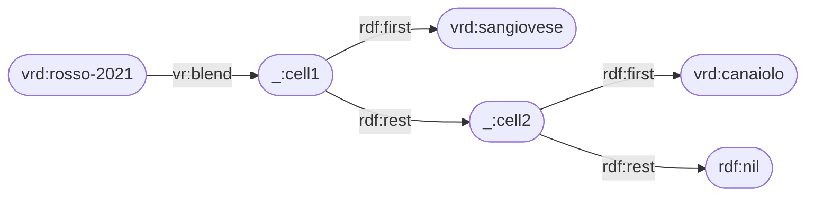

> The catalog lists the grapes of every wine twice: unordered with `vr:grape` and in order of share with `vr:blend`. The cooperative now writes a blend by hand to see what the order costs. It also adds a thing the catalog never had: the awards of the Valley Vin Santo.
{: .story}

## Two ways to group

RDF has no array. To say that a wine is made of Sangiovese **and** Canaiolo, you could write two triples with `vr:grape` and the catalog does. That says nothing about which grape is the main one and nothing about whether the list is complete. For those two things RDF offers a structure that is itself made of triples:

| | Collection | Container |
|---|---|---|
| Class | `RDFCollection` | `RDFContainer` |
| Meaning | a closed list: these items and no more | an open group: these items so far |
| Order | always kept | depends on the type |
| Duplicates in RDFSharp | refused | depend on the type |
| In RDF | `rdf:first` and `rdf:rest` cells ending in `rdf:nil` | one resource with `rdf:_1`, `rdf:_2`... |

A container has a type, chosen with `RDFModelEnums.RDFContainerTypes`:

| Type | Class in RDF | Order | Duplicates |
|---|---|---|---|
| `Bag` | `rdf:Bag` | no meaning | allowed |
| `Seq` | `rdf:Seq` | meaningful | allowed |
| `Alt` | `rdf:Alt` | none: the items are alternatives | refused |

RDF itself allows the same item twice in a list or in a container: refusing duplicates is a choice of RDFSharp, which `AddItem` applies without an error. Both kinds also declare what their items are, with `RDFModelEnums.RDFItemTypes`: `Resource` or `Literal`.

## A collection: the blend

The blend of the Vallerosa Red lists Sangiovese first, then Canaiolo. The items are resources, so the collection is made of `Resource` items:

```csharp
using RDFSharp.Model;

RDFNamespace vr = new RDFNamespace("vr", "https://vallerosa.example/vocab#");
RDFNamespace vrd = new RDFNamespace("vrd", "https://vallerosa.example/id/");
RDFNamespaceRegister.AddNamespace(vr);
RDFNamespaceRegister.AddNamespace(vrd);

RDFResource rosso = new RDFResource(vrd + "rosso-2021");
RDFResource sangiovese = new RDFResource(vrd + "sangiovese");
RDFResource canaiolo = new RDFResource(vrd + "canaiolo");

RDFCollection blend = new RDFCollection(RDFModelEnums.RDFItemTypes.Resource)
    .AddItem(sangiovese)
    .AddItem(canaiolo)
    .AddItem(sangiovese)
    .AddItem(new RDFPlainLiteral("Merlot"));
Console.WriteLine(blend.ItemsCount);
```

<div class="result" markdown="1">

```
2
```

</div>

Four items went in and two stayed. The second Sangiovese is a duplicate and the Merlot is a literal where the collection wants resources: `AddItem` ignores both without an error. `RemoveItem` and `ClearItems` take items out and enumerating the collection gives the items in order.

## How a graph stores it

A collection is not a triple, so it must be turned into some. `AddCollection` does it and a triple from the wine to the collection joins the two. The wine points to the collection through its `ReificationSubject`: the first cell of the list.

```csharp
RDFGraph wines = new RDFGraph()
    .SetContext(new Uri("https://vallerosa.example/catalog"))
    .AddCollection(blend)
    .AddTriple(new RDFTriple(rosso, new RDFResource(vr + "blend"), blend.ReificationSubject));
Console.WriteLine(wines.TriplesCount);
wines.ToFile(RDFModelEnums.RDFFormats.Turtle, "blend.ttl");
```

<div class="result" markdown="1">

```
7
```

</div>

<div class="result" data-label="blend.ttl" markdown="1">

```turtle
@prefix rdf: <http://www.w3.org/1999/02/22-rdf-syntax-ns#>.
@prefix vr: <https://vallerosa.example/vocab#>.
@prefix vrd: <https://vallerosa.example/id/>.
@base <https://vallerosa.example/catalog>.

_:01efac12ba8449d9ad5099fbe55e7a5e rdf:first vrd:sangiovese; 
                                   rdf:rest _:b2a5e5d7b86946f38ce0285c2319f630; 
                                   a rdf:List. 
_:b2a5e5d7b86946f38ce0285c2319f630 rdf:first vrd:canaiolo; 
                                   rdf:rest rdf:nil; 
                                   a rdf:List. 
vrd:rosso-2021 vr:blend _:01efac12ba8449d9ad5099fbe55e7a5e. 
```

</div>

Seven triples: one for the link and for each of the two items a cell with three triples (its type `rdf:List`, its `rdf:first` item and its `rdf:rest`). The names starting with `_:` are blank resources, invented anew at every run, which is the right use of them: nobody needs a name for the cell of a list. Here is the chain that the file describes:



The order of the blend is the order of the chain: you reach Canaiolo only by passing through the cell of Sangiovese. A list that ends in `rdf:nil` is closed, because nothing can be added after the end. An empty collection is `rdf:nil` itself and takes no triples.

Reading a list back is walking this chain. The catalog stores the blend of every wine as such a list and the Vin Santo is the one whose blend does not follow the order of its `vr:grape` triples:

```csharp
RDFGraph catalog = RDFGraph.FromFile(RDFModelEnums.RDFFormats.Turtle, "vallerosa-catalog.ttl");
RDFResource vinsanto = new RDFResource(vrd + "vinsanto-2015");

RDFResource cell = (RDFResource)catalog.SelectTriples(s: vinsanto, p: new RDFResource(vr + "blend"))[0].Object;
while (!cell.Equals(RDFVocabulary.RDF.NIL))
{
    Console.WriteLine(catalog.SelectTriples(s: cell, p: RDFVocabulary.RDF.FIRST)[0].Object);
    cell = (RDFResource)catalog.SelectTriples(s: cell, p: RDFVocabulary.RDF.REST)[0].Object;
}
```

<div class="result" markdown="1">

```
https://vallerosa.example/id/malvasia
https://vallerosa.example/id/trebbiano
```

</div>

The Valley Vin Santo is mostly Malvasia, with Trebbiano after it. A query that asks for the grapes of the wine, with `vr:grape`, returns them in no particular order. Only the list knows the shares. The [property paths]({{ '/query/property-paths/' | relative_url }}) chapter is about walking chains of links like this one with a single query.

## A container: the awards

The Valley Vin Santo won two prizes. They are texts, they have no order that matters and nobody can say that the list is complete: a bag of literals.

```csharp
RDFContainer awards = new RDFContainer(RDFModelEnums.RDFContainerTypes.Bag, RDFModelEnums.RDFItemTypes.Literal)
    .AddItem(new RDFPlainLiteral("Gold, Concorso Vini di Siena 2023"))
    .AddItem(new RDFPlainLiteral("Best Sweet Wine, Tuscan Cellars Fair 2024"));
Console.WriteLine(awards.ItemsCount);

RDFGraph sweet = new RDFGraph()
    .SetContext(new Uri("https://vallerosa.example/catalog"))
    .AddContainer(awards)
    .AddTriple(new RDFTriple(vinsanto, new RDFResource(vr + "awards"), awards.ReificationSubject));
Console.WriteLine(sweet.TriplesCount);
sweet.ToFile(RDFModelEnums.RDFFormats.Turtle, "awards.ttl");
```

<div class="result" markdown="1">

```
2
4
```

</div>

<div class="result" data-label="awards.ttl" markdown="1">

```turtle
@prefix rdf: <http://www.w3.org/1999/02/22-rdf-syntax-ns#>.
@prefix vr: <https://vallerosa.example/vocab#>.
@prefix vrd: <https://vallerosa.example/id/>.
@base <https://vallerosa.example/catalog>.

_:e493c35ac08745178e7633e6f4c71cb7 rdf:_1 "Gold, Concorso Vini di Siena 2023"; 
                                   rdf:_2 "Best Sweet Wine, Tuscan Cellars Fair 2024"; 
                                   a rdf:Bag. 
vrd:vinsanto-2015 vr:awards _:e493c35ac08745178e7633e6f4c71cb7. 
```

</div>

Four triples: the link, the type `rdf:Bag` and one `rdf:_N` property for each item. The property names are what carry the position, so a container of three items has `rdf:_1`, `rdf:_2` and `rdf:_3` and that is also why a container can be extended by anyone who knows the next number.

Two choices of this example are the cooperative's, not the library's. `vr:awards` is the property of the vocabulary for prizes, with a bag as its range. The prizes are literals, which is the simplest form: if the awards had a date and a jury, each would be a resource of its own and the container would hold resources.

The graph methods that put the groups into a graph have asynchronous twins: `AddCollectionAsync` and `AddContainerAsync`.

> Collections and containers can only be added to a graph, never read from one with a single call. When the data comes from a file, a walk of the cells as above, or a SPARQL query with a property path, is the way to read them.
{: .tip}
