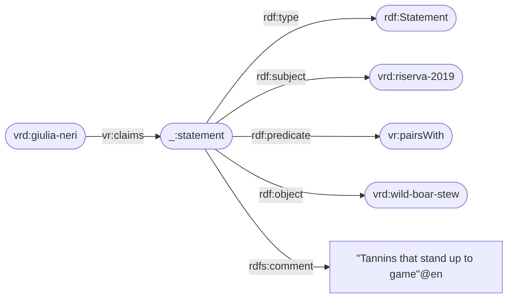

> The sommelier Giulia Neri says that the Vallerosa Reserve goes well with wild boar stew. The cooperative likes the advice but is not ready to print it in the catalog as a fact: it wants to keep who said it.
{: .story}

## A claim is not a fact

Every triple in a graph is asserted: the graph says it. If the cooperative adds `vrd:riserva-2019 vr:pairsWith vrd:wild-boar-stew`, the catalog says that the Reserve goes with wild boar stew, with no author and no doubt attached. A query for the pairings of the Reserve would return the stew as if the cooperative had decided it.

What the cooperative knows is something else: *Giulia Neri claims that* the Reserve goes with the stew. To say that, a triple must become the **object of another triple** and RDF 1.1 does not let a triple be a term. The way out is **reification**: describe the triple with other triples, give that description a name and talk about the name.

Two names are new at Vallerosa in this chapter: `vrd:giulia-neri` is a `vr:Person` and `vrd:wild-boar-stew` is a `vr:Dish`. The property that links a person to what that person says is `vr:claims`, from the vocabulary.

```csharp
using RDFSharp.Model;
using RDFSharp.Query;

RDFNamespace vr = new RDFNamespace("vr", "https://vallerosa.example/vocab#");
RDFNamespace vrd = new RDFNamespace("vrd", "https://vallerosa.example/id/");

RDFResource giulia = new RDFResource(vrd + "giulia-neri");
RDFResource riserva = new RDFResource(vrd + "riserva-2019");
RDFResource stew = new RDFResource(vrd + "wild-boar-stew");
RDFResource claims = new RDFResource(vr + "claims");

RDFTriple pairing = new RDFTriple(riserva, new RDFResource(vr + "pairsWith"), stew);
Console.WriteLine(pairing);
Console.WriteLine(pairing.ReificationSubject);
```

<div class="result" markdown="1">

```
https://vallerosa.example/id/riserva-2019 https://vallerosa.example/vocab#pairsWith https://vallerosa.example/id/wild-boar-stew
bnode:-2283882414796470298
```

</div>

The triple exists as an object in memory, in no graph. Its `ReificationSubject` is the **representative** of the triple: a blank resource whose name the library derives from the triple, so the same triple always has the same representative. That stable name is what other statements can point to.

(`using RDFSharp.Query` is for `RDFPatternMember`, the type that the annotations below use for their objects.)

## Classic reification

`ReifyTriple` builds a small graph that describes the triple with four statements, in the RDF 1.1 way: the representative is an `rdf:Statement` and has the subject, the predicate and the object of the triple as its `rdf:subject`, `rdf:predicate` and `rdf:object`.

```csharp
RDFGraph reified = pairing.ReifyTriple();
Console.WriteLine(reified.TriplesCount);
Console.WriteLine(await reified.ContainsTripleAsync(pairing));
foreach (RDFTriple triple in reified)
    Console.WriteLine($"{triple.Predicate} | {triple.Object}");
```

<div class="result" markdown="1">

```
4
False
http://www.w3.org/1999/02/22-rdf-syntax-ns#type | http://www.w3.org/1999/02/22-rdf-syntax-ns#Statement
http://www.w3.org/1999/02/22-rdf-syntax-ns#subject | https://vallerosa.example/id/riserva-2019
http://www.w3.org/1999/02/22-rdf-syntax-ns#predicate | https://vallerosa.example/vocab#pairsWith
http://www.w3.org/1999/02/22-rdf-syntax-ns#object | https://vallerosa.example/id/wild-boar-stew
```

</div>

Four triples describe the pairing and the pairing itself is not among them: describing a statement is not asserting it. This is the whole point. A graph that holds this description knows that the statement exists and says nothing about its truth.

## Who said it

The description is a resource, so it can be the object of a triple and the subject of others. The cooperative links Giulia to the representative with `vr:claims` and adds an **annotation**: a note on the statement itself, a pair of a predicate and an object that `ReifyTriple` attaches to the representative. The graph is then merged into the catalog:

```csharp
RDFGraph catalog = new RDFGraph()
    .SetContext(new Uri("https://vallerosa.example/catalog"))
    .AddTriple(new RDFTriple(giulia, RDFVocabulary.RDF.TYPE, new RDFResource(vr + "Person")))
    .AddTriple(new RDFTriple(giulia, RDFVocabulary.RDFS.LABEL, new RDFPlainLiteral("Giulia Neri")))
    .AddTriple(new RDFTriple(stew, RDFVocabulary.RDF.TYPE, new RDFResource(vr + "Dish")))
    .AddTriple(new RDFTriple(stew, RDFVocabulary.RDFS.LABEL, new RDFPlainLiteral("Wild boar stew", "en")));

RDFGraph annotated = pairing.ReifyTriple(new List<(RDFResource, RDFPatternMember)> {
    (RDFVocabulary.RDFS.COMMENT, new RDFPlainLiteral("Tannins that stand up to game", "en")) });
catalog = (await catalog.UnionWithAsync(annotated))
    .AddTriple(new RDFTriple(giulia, claims, pairing.ReificationSubject))
    .SetContext(new Uri("https://vallerosa.example/catalog"));

Console.WriteLine(catalog.TriplesCount);
Console.WriteLine(await catalog.ContainsTripleAsync(pairing));
Console.WriteLine((await catalog.SelectTriplesAsync(s: riserva, p: new RDFResource(vr + "pairsWith"))).Count);
foreach (RDFTriple triple in await catalog.SelectTriplesAsync(p: claims))
    Console.WriteLine($"{triple.Subject} | {triple.Object}");
```

<div class="result" markdown="1">

```
10
False
0
https://vallerosa.example/id/giulia-neri | bnode:-2283882414796470298
```

</div>

Ten triples: the four of Giulia and the stew, the four of the description, the annotation and the claim. The catalog does not contain the pairing and the Reserve has no `vr:pairsWith` triple at all, so a question about the pairings of the Reserve gets no answer. A question about what Giulia claims gets the representative and from it the whole statement and its annotation. Here is the picture:



The annotation object can be a resource or a literal. The same graph works for the sommelier's name, a date, a source or a degree of confidence: everything that is true of the claim, not of the pairing.

If the cooperative one day decides to endorse the advice, it adds the triple itself with `AddTriple(pairing)` and the claim stays beside it as the history of where the advice came from.

## RDF 1.2: triple terms

RDF 1.2 makes this pattern part of the model. A statement that you talk about without asserting it is a **triple term** and what talks about it is a **reifier**, linked to the term by `rdf:reifies`. `ReifyTripleTerm` builds that form: the same representative is the reifier. A graph of RDFSharp holds no triple terms of its own, so the library writes the term in the encoding that RDF 1.2 defines for that case: a second blank resource that carries the three parts as `rdf:ttSubject`, `rdf:ttPredicate` and `rdf:ttObject`. The annotations hang on the reifier:

```csharp
RDFGraph asTerm = pairing.ReifyTripleTerm(new List<(RDFResource, RDFPatternMember)> {
    (RDFVocabulary.RDFS.COMMENT, new RDFPlainLiteral("Tannins that stand up to game", "en")) });
Console.WriteLine(asTerm.TriplesCount);
foreach (RDFTriple triple in asTerm)
    Console.WriteLine($"{triple.Subject} | {triple.Predicate} | {triple.Object}");
```

<div class="result" markdown="1">

```
6
bnode:-2283882414796470298 | http://www.w3.org/1999/02/22-rdf-syntax-ns#reifies | bnode:TT-2283882414796470298
bnode:TT-2283882414796470298 | http://www.w3.org/1999/02/22-rdf-syntax-ns#type | http://www.w3.org/1999/02/22-rdf-syntax-ns#TripleTerm
bnode:TT-2283882414796470298 | http://www.w3.org/1999/02/22-rdf-syntax-ns#ttSubject | https://vallerosa.example/id/riserva-2019
bnode:TT-2283882414796470298 | http://www.w3.org/1999/02/22-rdf-syntax-ns#ttPredicate | https://vallerosa.example/vocab#pairsWith
bnode:TT-2283882414796470298 | http://www.w3.org/1999/02/22-rdf-syntax-ns#ttObject | https://vallerosa.example/id/wild-boar-stew
bnode:-2283882414796470298 | http://www.w3.org/2000/01/rdf-schema#comment | Tannins that stand up to game@EN
```

</div>

The sentence that links Giulia to the claim is the same in both forms, because it points to the representative: `giulia vr:claims pairing.ReificationSubject`. Choose the classic form to be read by every RDF tool in use today and the triple-term form to follow RDF 1.2. The cooperative uses the classic one.

## Other things that reify

A triple is not the only thing that RDFSharp turns into triples. The graph methods `AddContainer` and `AddCollection` of the [previous chapter]({{ '/model/containers/' | relative_url }}) reify a container or a collection and a quadruple of a store, a triple with a context, has its own reification in the [Store chapters]({{ '/store/quadruples/' | relative_url }}).
