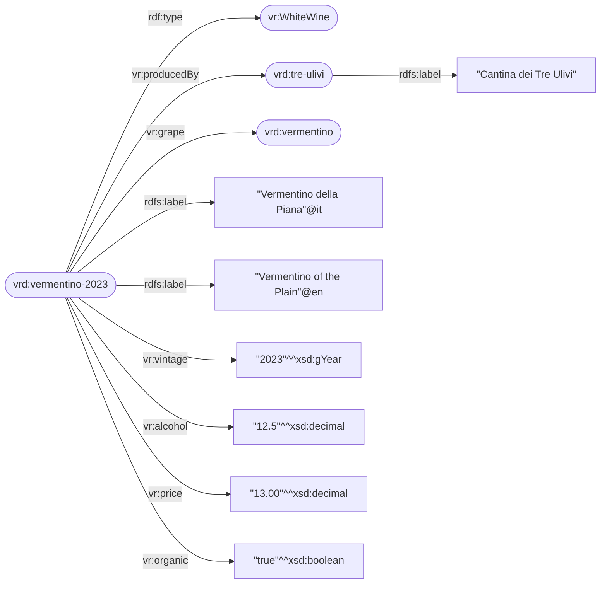

> Cantina dei Tre Ulivi is the first winery to hand over its data and the cooperative decides to type the Vermentino of the Plain 2023 in by hand, triple by triple. Nothing teaches the model better than describing a wine one statement at a time.
{: .story}

This chapter needs one namespace of the library, plus the two prefixes of the case:

```csharp
using RDFSharp.Model;

RDFNamespace vr = new RDFNamespace("vr", "https://vallerosa.example/vocab#");
RDFNamespace vrd = new RDFNamespace("vrd", "https://vallerosa.example/id/");
```

## Resources

A **resource** is something you can talk about: a wine, a winery, a grape. It is named by an IRI, a Web address that works as a unique name and never has to resolve to a page. In RDFSharp a resource is an `RDFResource`.

```csharp
RDFResource vermentino = new RDFResource(vrd + "vermentino-2023");
RDFResource treUlivi = new RDFResource(vrd + "tre-ulivi");
RDFResource draft = new RDFResource();

Console.WriteLine(vermentino);
Console.WriteLine(vermentino.IsBlank);
Console.WriteLine(draft.IsBlank);
```

<div class="result" markdown="1">

```
https://vallerosa.example/id/vermentino-2023
False
True
```

</div>

The first two resources are **named**: their IRI is the one you gave. The third has no argument, so the library invents a name for it and it is a **blank resource**, one that exists in the graph but has no IRI of its own. Blank resources are handy for things that matter only through their links, such as the cells of a list. You meet them again in [Containers and collections]({{ '/model/containers/' | relative_url }}).

The `vrd + "..."` form is a convenience of `RDFNamespace`: it glues the namespace and the local name into one IRI string. [Namespaces and vocabularies]({{ '/model/namespaces/' | relative_url }}) tells the rest.

## Plain literals

A **literal** is a value written down as it is: a name, a year, a price. The simplest kind is the `RDFPlainLiteral`, a piece of text. It can carry a **language tag**, which says in which language people read it. The name comes from RDF 1.0. Since RDF 1.1 every literal has a datatype (`xsd:string` for bare text, `rdf:langString` for text with a tag): RDFSharp still calls these literals plain, to tell them from the typed ones of the next section.

```csharp
RDFPlainLiteral producerName = new RDFPlainLiteral("Cantina dei Tre Ulivi");
RDFPlainLiteral nameEn = new RDFPlainLiteral("Vermentino of the Plain", "en");
RDFPlainLiteral nameIt = new RDFPlainLiteral("Vermentino della Piana", "it");

Console.WriteLine(producerName);
Console.WriteLine(nameEn);
```

<div class="result" markdown="1">

```
Cantina dei Tre Ulivi
Vermentino of the Plain@EN
```

</div>

A winery's name is a proper name, so it gets no tag. A wine's label is read in a language, so it gets one and the Vermentino carries two labels at once. The library writes tags in upper case: language tags are case insensitive and one spelling keeps two equal tags equal.

RDF 1.2 adds the **base direction** of a text, the side from which it is read. You express it in the tag itself, with the suffix `--ltr` (left to right) or `--rtl` (right to left):

```csharp
RDFPlainLiteral nameLtr = new RDFPlainLiteral("Vermentino of the Plain", "en--ltr");

Console.WriteLine(nameLtr);
Console.WriteLine(nameLtr.HasDirection());
Console.WriteLine(nameEn.HasDirection());
```

<div class="result" markdown="1">

```
Vermentino of the Plain@EN--LTR
True
False
```

</div>

A tag that is not well formed is not an error: the library drops it and keeps the text as a plain literal without language.

## Typed literals

Text alone is a poor way to store a number. Is `12.5` an amount of alcohol or a section number? Is `2023` a year or a quantity? A **typed literal**, an `RDFTypedLiteral`, answers with a **datatype**: the value comes with the name of the kind of value it is. The datatypes are those of XML Schema, listed in the `RDFModelEnums.RDFDatatypes` enumeration.

```csharp
RDFTypedLiteral vintage = new RDFTypedLiteral("2023", RDFModelEnums.RDFDatatypes.XSD_GYEAR);
RDFTypedLiteral alcohol = new RDFTypedLiteral("12.5", RDFModelEnums.RDFDatatypes.XSD_DECIMAL);
RDFTypedLiteral price = new RDFTypedLiteral("13.00", RDFModelEnums.RDFDatatypes.XSD_DECIMAL);
RDFTypedLiteral organic = new RDFTypedLiteral("true", RDFModelEnums.RDFDatatypes.XSD_BOOLEAN);

Console.WriteLine(vintage);
Console.WriteLine(alcohol);
Console.WriteLine(price);
Console.WriteLine(organic);
```

<div class="result" markdown="1">

```
2023Z^^http://www.w3.org/2001/XMLSchema#gYear
12.5^^http://www.w3.org/2001/XMLSchema#decimal
13.00^^http://www.w3.org/2001/XMLSchema#decimal
true^^http://www.w3.org/2001/XMLSchema#boolean
```

</div>

Two things happen here. The first is that the library **checks the value against its datatype** when it builds the literal, so a typed literal that exists is a well formed one. The next chapters show what the check refuses. The second is the `Z` on the year: the library writes a year without a time zone as a year in UTC, which in XML Schema is not the same value. Keep it in mind when you compare years with data from other tools.

The datatype is part of the identity of a literal. The text `12.5` and the decimal `12.5` are two different literals:

```csharp
RDFPlainLiteral alcoholAsText = new RDFPlainLiteral("12.5");

Console.WriteLine(alcohol.Equals(alcoholAsText));
Console.WriteLine(alcohol.HasDecimalDatatype());
```

<div class="result" markdown="1">

```
False
True
```

</div>

This is the reason the datatype matters. A query that asks for the wines under 13 degrees compares numbers and a shape that asks for a decimal between 5 and 20 checks a decimal. Both only work on values that declared what they are, which is why every number of the catalog is typed. The [Datatypes and facets]({{ '/model/datatypes/' | relative_url }}) chapter goes deeper.

## Triples

A **triple** is one statement: a **subject** (who we speak about), a **predicate** (what we say) and an **object** (the value of it). The subject and the predicate are resources. The object is either a resource or a literal, so the library offers two constructors and the triple takes one of two **flavors**: `SPO` when the object is a resource and `SPL` when it is a literal.

```csharp
RDFTriple producedBy = new RDFTriple(vermentino, new RDFResource(vr + "producedBy"), treUlivi);
RDFTriple hasVintage = new RDFTriple(vermentino, new RDFResource(vr + "vintage"), vintage);

Console.WriteLine(producedBy.TripleFlavor);
Console.WriteLine(hasVintage.TripleFlavor);
Console.WriteLine(hasVintage);
```

<div class="result" markdown="1">

```
SPO
SPL
https://vallerosa.example/id/vermentino-2023 https://vallerosa.example/vocab#vintage 2023Z^^http://www.w3.org/2001/XMLSchema#gYear
```

</div>

The library refuses what RDF does not allow. The predicate of a triple must be a named resource, because a statement needs a verb that everybody can recognize:

```csharp
try
{
    RDFTriple refused = new RDFTriple(vermentino, new RDFResource(), treUlivi);
}
catch (RDFModelException ex)
{
    Console.WriteLine(ex.Message);
}
```

<div class="result" markdown="1">

```
Cannot create RDFTriple because given "pred" parameter is a blank resource
```

</div>

Every error raised by the model layer is an `RDFModelException`, so one `catch` is enough to guard a whole import.

## The whole description

The Vermentino and its producer make ten triples: nine about the wine and one that gives the winery its name. Here they are as a picture:



The stadiums are resources and the boxes are literals: the arrows to the right of the wine end in a resource or in a value and that is exactly the difference between the two flavors. The same triples in Turtle and in C#:

<div class="pair" markdown="1">

```turtle
@prefix vr:   <https://vallerosa.example/vocab#> .
@prefix vrd:  <https://vallerosa.example/id/> .
@prefix rdfs: <http://www.w3.org/2000/01/rdf-schema#> .
@prefix xsd:  <http://www.w3.org/2001/XMLSchema#> .

vrd:vermentino-2023 a vr:WhiteWine ;
    rdfs:label "Vermentino della Piana"@it, "Vermentino of the Plain"@en ;
    vr:producedBy vrd:tre-ulivi ;
    vr:vintage "2023"^^xsd:gYear ;
    vr:alcohol 12.5 ;
    vr:price 13.00 ;
    vr:organic true ;
    vr:grape vrd:vermentino .

vrd:tre-ulivi rdfs:label "Cantina dei Tre Ulivi" .
```

```csharp
RDFGraph catalog = new RDFGraph()
    .SetContext(new Uri("https://vallerosa.example/catalog"))
    .AddTriple(new RDFTriple(vermentino, RDFVocabulary.RDF.TYPE, new RDFResource(vr + "WhiteWine")))
    .AddTriple(new RDFTriple(vermentino, RDFVocabulary.RDFS.LABEL, nameIt))
    .AddTriple(new RDFTriple(vermentino, RDFVocabulary.RDFS.LABEL, nameEn))
    .AddTriple(producedBy)
    .AddTriple(hasVintage)
    .AddTriple(new RDFTriple(vermentino, new RDFResource(vr + "alcohol"), alcohol))
    .AddTriple(new RDFTriple(vermentino, new RDFResource(vr + "price"), price))
    .AddTriple(new RDFTriple(vermentino, new RDFResource(vr + "organic"), organic))
    .AddTriple(new RDFTriple(vermentino, new RDFResource(vr + "grape"), new RDFResource(vrd + "vermentino")))
    .AddTriple(new RDFTriple(treUlivi, RDFVocabulary.RDFS.LABEL, producerName));

Console.WriteLine(catalog.TriplesCount);
```

</div>

<div class="result" markdown="1">

```
10
```

</div>

Ten triples are the ten arrows of the picture. In Turtle `a` stands for `rdf:type` and a bare `12.5` or `true` is already a typed literal, while the C# side spells out the datatypes. The properties of the vocabulary (`vr:`) are plain resources that you build from the namespace, whereas the ones of RDF itself come ready in `RDFVocabulary`: `RDFVocabulary.RDF.TYPE` and `RDFVocabulary.RDFS.LABEL` appear above.

> A graph never stores the same triple twice: adding an existing triple does nothing. The next chapter, [Graphs]({{ '/model/graphs/' | relative_url }}), shows how to manage a whole set of them.
{: .tip}
