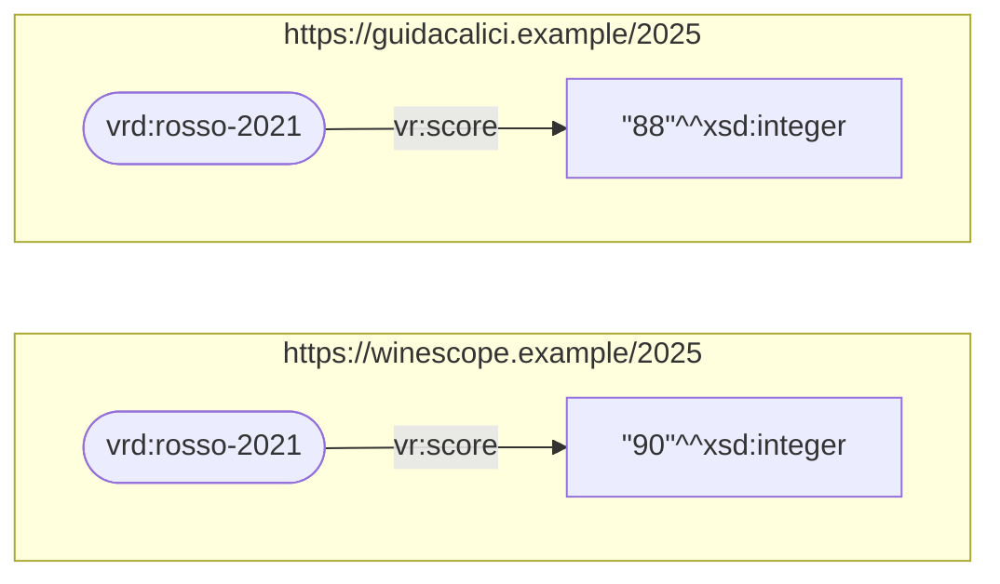

> Two wine guides have reviewed the Vallerosa wines and they do not agree: Guida ai Calici gives the Vallerosa Red 88 and WineScope gives it 90. The cooperative wants to keep both scores and always know whose each one is.
{: .story}

## Why a triple is not enough

In the [Model]({{ '/model/triples/' | relative_url }}) chapters every fact is a triple: subject, predicate, object. A graph is a set of triples. A set holds each triple at most once. That is exactly the problem here. The two guides say something about the same subject with the same predicate:

- `vrd:rosso-2021 vr:score 88` according to Guida ai Calici
- `vrd:rosso-2021 vr:score 90` according to WineScope

Put in one graph, the two triples sit side by side and nothing says which belongs to which guide. Worse, if both guides had said 88 there would be a single triple left and the information that two sources agree would be gone. On the open Web the same triple really can come from many places, so RDF data needs a way to track its **provenance**: where a fact comes from.

The answer is a fourth element. A triple that carries the name of its source is a **quadruple**. The source is its **context**. The two scores become two different facts, each one filed under the guide that stated it.



The diagram shows how a store sees the data: one box for each context with a small graph inside it. The subject is the same on both sides. What differs is the box it sits in.

## Contexts

A context is an IRI. RDFSharp models it with `RDFContext` from the `RDFSharp.Store` namespace. You can build one from a string, from a `Uri` or without arguments.

```csharp
using RDFSharp.Model;
using RDFSharp.Store;

RDFContext guidaCalici = new RDFContext("https://guidacalici.example/2025");
RDFContext winescope = new RDFContext(new Uri("https://winescope.example/2025"));
RDFContext defaultContext = new RDFContext();
Console.WriteLine(defaultContext);
```

<div class="result" markdown="1">

```
https://rdfsharp.codeplex.com/
```

</div>

The parameterless constructor gives the **default context**, the default namespace of the library. It is what a fact gets when nobody says where it comes from. It works as a placeholder but it is a poor name for a real source: give every fact a context of your own whenever you can.

A context must be an absolute IRI that does not stand for a blank node, since its whole purpose is to answer "where does this fact come from?" with something you can name.

## Quadruples

`RDFQuadruple` takes the context first and then the three parts of the triple, as in the other classes of the library: a resource as the object gives a quadruple with the `SPO` flavor, a literal gives the `SPL` flavor. Here are the two scores and one fact of the catalog, which lives in its own context.

```csharp
RDFNamespace vr = new RDFNamespace("vr", "https://vallerosa.example/vocab#");
RDFNamespace vrd = new RDFNamespace("vrd", "https://vallerosa.example/id/");

RDFResource rosso = new RDFResource(vrd + "rosso-2021");
RDFResource poggioAlto = new RDFResource(vrd + "poggio-alto");
RDFResource score = new RDFResource(vr + "score");
RDFResource producedBy = new RDFResource(vr + "producedBy");

RDFQuadruple scoreInCalici = new RDFQuadruple(guidaCalici, rosso, score,
    new RDFTypedLiteral("88", RDFModelEnums.RDFDatatypes.XSD_INTEGER));
RDFQuadruple scoreInWinescope = new RDFQuadruple(winescope, rosso, score,
    new RDFTypedLiteral("90", RDFModelEnums.RDFDatatypes.XSD_INTEGER));
RDFQuadruple producer = new RDFQuadruple(
    new RDFContext("https://vallerosa.example/catalog"), rosso, producedBy, poggioAlto);

Console.WriteLine(scoreInCalici);
Console.WriteLine(scoreInWinescope);
Console.WriteLine(producer);
```

<div class="result" markdown="1">

```
https://guidacalici.example/2025 https://vallerosa.example/id/rosso-2021 https://vallerosa.example/vocab#score 88^^http://www.w3.org/2001/XMLSchema#integer
https://winescope.example/2025 https://vallerosa.example/id/rosso-2021 https://vallerosa.example/vocab#score 90^^http://www.w3.org/2001/XMLSchema#integer
https://vallerosa.example/catalog https://vallerosa.example/id/rosso-2021 https://vallerosa.example/vocab#producedBy https://vallerosa.example/id/poggio-alto
```

</div>

A quadruple prints as context, subject, predicate and object, separated by spaces. Each part is also a property of the quadruple. `TripleFlavor` tells which kind of object it holds:

```csharp
Console.WriteLine(scoreInCalici.Context);
Console.WriteLine(scoreInCalici.Object);
Console.WriteLine(scoreInCalici.TripleFlavor);   // SPL
Console.WriteLine(producer.TripleFlavor);        // SPO
```

<div class="result" markdown="1">

```
https://guidacalici.example/2025
88^^http://www.w3.org/2001/XMLSchema#integer
SPL
SPO
```

</div>

| Property | Holds |
|---|---|
| `Context` | the source of the fact |
| `Subject`, `Predicate`, `Object` | the three parts of the triple, as pattern members |
| `TripleFlavor` | `SPO` when the object is a resource, `SPL` when it is a literal |
| `QuadrupleID` | a number that identifies the quadruple: it depends on all four parts |

## Same triple, two contexts

When you already have a triple, give it a context with the other constructor. Suppose WineScope also lists the producer of the Vallerosa Red, the same fact the catalog states. Two quadruples come out of one triple. They are different:

```csharp
RDFTriple producerTriple = new RDFTriple(rosso, producedBy, poggioAlto);
RDFQuadruple fromCatalog = new RDFQuadruple(new RDFContext("https://vallerosa.example/catalog"), producerTriple);
RDFQuadruple fromWinescope = new RDFQuadruple(winescope, producerTriple);

Console.WriteLine(fromCatalog.Equals(producer));
Console.WriteLine(fromCatalog.Equals(fromWinescope));
```

<div class="result" markdown="1">

```
True
False
```

</div>

The first comparison is `True`: the quadruple built from the triple is the one built from its parts, so quadruples are compared by value, context included. The second is `False`: the same triple in two contexts is two quadruples. That is how a store can keep every opinion of every source and still tell them apart. It is also how the cooperative can later ask where a fact comes from or count the sources that agree on it.

## What the library refuses

A quadruple follows the rules of RDF. The constructors enforce them with an `RDFStoreException` whose message names the problem. A predicate cannot be a blank node. A context cannot be a blank node or something that is not an IRI. A triple cannot be missing either:

```csharp
try
{
    new RDFQuadruple(guidaCalici, rosso, new RDFResource(), poggioAlto);
}
catch (RDFStoreException ex)
{
    Console.WriteLine(ex.Message);
}

try
{
    new RDFContext("_:guide");
}
catch (RDFStoreException ex)
{
    Console.WriteLine(ex.Message);
}

try
{
    new RDFContext("guida calici");
}
catch (RDFStoreException ex)
{
    Console.WriteLine(ex.Message);
}

try
{
    new RDFQuadruple(guidaCalici, null);
}
catch (RDFStoreException ex)
{
    Console.WriteLine(ex.Message);
}
```

<div class="result" markdown="1">

```
Cannot create RDFQuadruple because given "pred" parameter is a blank resource
Cannot create RDFContext because given "ctxUri" parameter represents a blank node Uri.
Cannot create RDFContext because given "ctxUri" parameter is null or does not represent a valid Uri.
Cannot create RDFQuadruple because given "triple" parameter is null
```

</div>

The subject is more forgiving: a blank node is a legitimate subject. `new RDFResource()` with no argument gives a fresh one. A missing context is forgiven as well, but silently: passing `null` where the context goes gives the quadruple the default context.

> **Where next.** A single quadruple is little use alone. [Memory stores]({{ '/store/stores/' | relative_url }}) collect them: the catalog and the two guides move into one store. The cooperative asks which guide reviewed which wine.
{: .tip}
