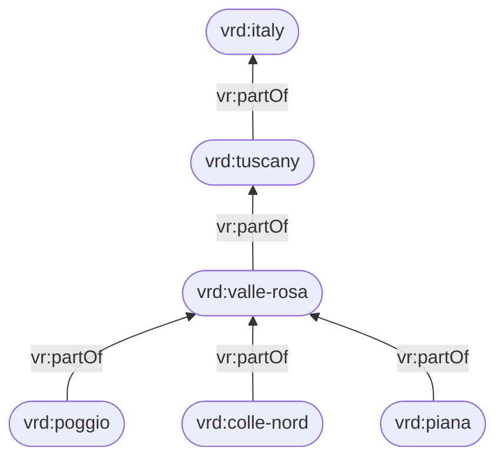

The cooperative, its wineries and its wines are fictional. The grapes and the regions are real. Every IRI lives under `vallerosa.example`, a domain reserved for examples.

## The files

<div class="cards">
  <a class="card" href="{{ '/assets/data/vallerosa-vocab.ttl' | relative_url }}"><span class="kind">Turtle · 135 triples</span><h3>vallerosa-vocab.ttl</h3><p>The vocabulary: classes and properties.</p></a>
  <a class="card" href="{{ '/assets/data/vallerosa-catalog.ttl' | relative_url }}"><span class="kind">Turtle · 143 triples</span><h3>vallerosa-catalog.ttl</h3><p>The catalog: wineries, areas, grapes and six wines.</p></a>
  <a class="card" href="{{ '/assets/data/vallerosa-guides.trig' | relative_url }}"><span class="kind">TriG · 10 quadruples</span><h3>vallerosa-guides.trig</h3><p>The scores of two wine guides, one named graph each.</p></a>
  <a class="card" href="{{ '/assets/data/vallerosa-sales.ttl' | relative_url }}"><span class="kind">Turtle · 108 triples</span><h3>vallerosa-sales.ttl</h3><p>The map and the 2025 sales to six partner shops.</p></a>
  <a class="card" href="{{ '/assets/data/vallerosa-shapes.ttl' | relative_url }}"><span class="kind">Turtle · 47 triples</span><h3>vallerosa-shapes.ttl</h3><p>The rules of the catalog as SHACL shapes.</p></a>
</div>

| Prefix | Namespace | Holds |
|---|---|---|
| `vr:` | `https://vallerosa.example/vocab#` | the vocabulary |
| `vrd:` | `https://vallerosa.example/id/` | the data |

## Wineries and places

| Winery | Subzone | Makes |
|---|---|---|
| Fattoria Poggio Alto (`vrd:poggio-alto`) | Hilltop (`vrd:poggio`) | the two reds |
| Tenuta Le Crete (`vrd:le-crete`) | North Hill (`vrd:colle-nord`) | the white blend and the Vin Santo |
| Cantina dei Tre Ulivi (`vrd:tre-ulivi`) | The Plain (`vrd:piana`) | the Vermentino and the rosé |

The three subzones are `vr:partOf` the valley, which is part of Tuscany:



## The wines

| Wine | Type | Vintage | Alcohol | Price (€) | Organic | Blend |
|---|---|---|---|---|---|---|
| `vrd:rosso-2021` Vallerosa Red | `vr:RedWine` | 2021 | 13.5 | 14.50 | no | Sangiovese, Canaiolo |
| `vrd:riserva-2019` Vallerosa Reserve | `vr:RedWine` | 2019 | 14.0 | 32.00 | no | Sangiovese |
| `vrd:bianco-2023` Le Crete White | `vr:WhiteWine` | 2023 | 12.0 | 11.00 | yes | Trebbiano, Malvasia |
| `vrd:vinsanto-2015` Valley Vin Santo | `vr:SweetWine` | 2015 | 16.0 | 38.00 | no | Malvasia, Trebbiano |
| `vrd:vermentino-2023` Vermentino of the Plain | `vr:WhiteWine` | 2023 | 12.5 | 13.00 | yes | Vermentino |
| `vrd:rosato-2024` Valley Rosé | `vr:RoseWine` | 2024 | 12.0 | 10.00 | no | Sangiovese |

One of them as the catalog writes it. Each grape is linked with `owl:sameAs` to DBpedia.

```turtle
vrd:rosso-2021 a vr:RedWine ;
    rdfs:label "Rosso di Vallerosa"@it, "Vallerosa Red"@en ;
    vr:producedBy vrd:poggio-alto ;
    vr:vintage "2021"^^xsd:gYear ;
    vr:alcohol 13.5 ;
    vr:price 14.50 ;
    vr:organic false ;
    vr:grape vrd:sangiovese, vrd:canaiolo ;
    vr:blend ( vrd:sangiovese vrd:canaiolo ) .
```

## The vocabulary

RDF Schema only: classes, subclasses, properties with a domain and a range.

| Class | Main properties |
|---|---|
| `vr:Wine`, with `vr:RedWine`, `vr:WhiteWine`, `vr:RoseWine`, `vr:SweetWine` | `vr:producedBy`, `vr:vintage`, `vr:alcohol`, `vr:price`, `vr:organic`, `vr:grape`, `vr:blend`, `vr:score`, `vr:pairsWith`, `vr:awards` |
| `vr:Producer` | `vr:memberOf` a `vr:Cooperative`, `vr:locatedIn` a `vr:Area` |
| `vr:Area` | `vr:partOf` another area |
| `vr:Sale` | `vr:soldTo` a `vr:Shop`, `vr:soldWine`, `vr:bottles`, `vr:date` |
| `vr:Person` | `vr:claims` a statement |
| `vr:Grape`, `vr:Dish` | |

The datatype `vr:abv`, alcohol by volume, is a decimal from 0 to 20.

## Shops and sources

| Shop | City | Bottles in 2025 |
|---|---|---|
| Enoteca del Campo (`vrd:enoteca-del-campo`) | Siena | 180 |
| Bottega Arno (`vrd:bottega-arno`) | Florence | 198 |
| Cantinetta della Torre (`vrd:cantinetta-torre`) | Pisa | 132 |
| Vineria Due Torri (`vrd:due-torri`) | Bologna | 72 |
| Enoteca Sette Colli (`vrd:sette-colli`) | Rome | 42 |
| Enoteca dei Navigli (`vrd:navigli`) | Milan | 42 |

| Context | Source |
|---|---|
| `https://vallerosa.example/catalog` | the cooperative's catalog |
| `https://guidacalici.example/2025` | *Guida ai Calici*, an Italian guide |
| `https://winescope.example/2025` | *WineScope*, an international guide |

The two guides do not always agree: the Vallerosa Red gets 88 from one and 90 from the other.
